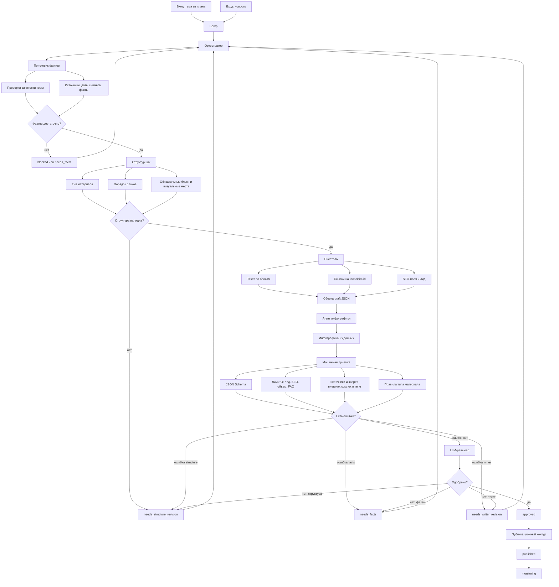

# Схема логики ИИ-конвейера

## Задача схемы

Документ показывает общий путь материала по автономному ИИ-конвейеру: от входящей темы или новости до публикации и мониторинга. Человек может запускать или смотреть процесс через Telegram-бота, но не является обязательной стадией согласования.

## Общая логика

## Роли агентов

- `Поисковик` собирает фактуру, проверяет источники, фиксирует URL, дату снимка и claims, которые можно использовать в финальном материале.
- `Оркестратор` хранит состояние процесса и решает, какой агент должен работать следующим.
- `Структурщик` выбирает тип материала, порядок блоков и обязательные смысловые элементы.
- `Писатель` заполняет блоки текстом и привязывает утверждения к фактам.
- `Агент инфографики` создает спецификации визуальных блоков только из структурированных данных.
- `Машинная приемка` бесплатно и детерминированно ловит ошибки до LLM-ревью.
- `LLM-ревьюер` проверяет смысл, полноту, пустые абзацы, риск выдумок и качество вывода.
- `Публикационный контур` отправляет approved-материал на сайт и переводит его в мониторинг.

## Главные возвраты на доработку

- Если проблема в источниках или фактах, материал возвращается в `needs_facts`.
- Если проблема в составе или порядке блоков, материал возвращается в `needs_structure_revision`.
- Если проблема в тексте, объеме, FAQ, SEO или ссылках, материал возвращается в `needs_writer_revision`.
- Если факты невозможно получить или правила допуска не позволяют продолжать, материал переходит в `blocked`.

## Что важно не сломать

- Финальный материал всегда собирается как строгий JSON `{ meta, blocks }`.
- LLM-ревью не запускается до машинной приемки.
- Инфографика выводится из данных, а не придумывается как картинка.
- Утверждения о фактах и конкурентах должны иметь источники.
- В финальном теле материала нельзя оставлять внешние ссылки на конкурентов или источники.
- Человек не является обязательным этапом процесса.
